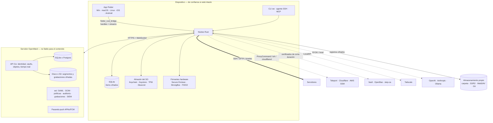
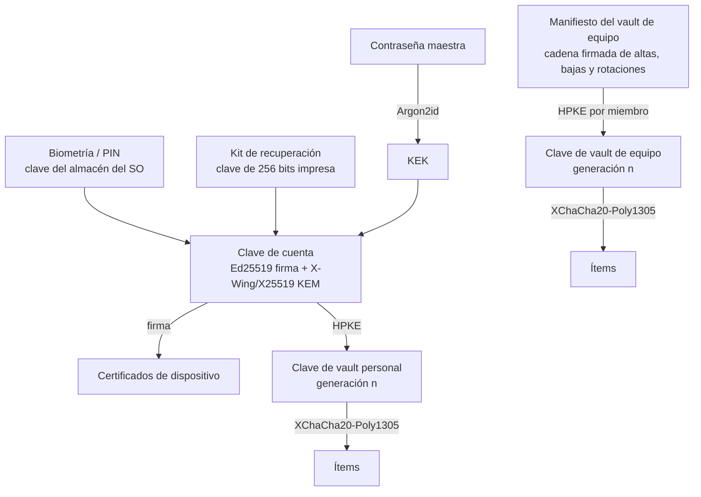

# Arquitectura y stack de OpenWard

**Estado:** propuesta v0.1 · **Fecha:** 2026-10-08 · [ADRs](adr/)

OpenWard es un cliente SSH open-core para Windows, macOS, Linux, iOS y Android. Es local-first y su vault de hosts y credenciales tiene formato abierto. La sincronización está cifrada de extremo a extremo (E2EE) y funciona con el almacenamiento del usuario, con un relay autoalojado o con el servicio alojado de pago. El dinero sale de servicios con coste real en el servidor: sincronización alojada, equipos y funciones enterprise. El cliente es 100 % open source y nunca tiene funciones capadas.

---

## 0. Decisiones en una tabla

| Área | Decisión | ADR |
|---|---|---|
| Reparto | **Núcleo Rust** compartido por todos los clientes, **UI Flutter** para las 5 plataformas y **servidor Go**. Es el mismo patrón que Arveil. | [ADR-001](adr/ADR-001-rust-core-flutter-go.md) |
| Terminal | Estado VT nativo (`alacritty_terminal` o `libghostty-vt`, que se decide en el spike) y render propio en Flutter. `xterm.dart` está descartado: sin versión desde febrero de 2024. | [ADR-002](adr/ADR-002-motor-de-terminal.md) |
| SSH | `russh` + `russh-sftp`, con un trait `Signer` para claves en software, agente, Secure Enclave, Keystore, TPM y FIDO2 | [ADR-003](adr/ADR-003-ssh-russh-y-firmantes.md) |
| Vault | Cifrado por ítem (XChaCha20-Poly1305) sobre SQLite. Jerarquía de claves con HPKE y kit de recuperación obligatorio. | [ADR-004](adr/ADR-004-vault-y-jerarquia-de-claves.md) |
| Sync | Registros inmutables por dispositivo, firmados y cifrados. Sirven para cualquier backend "tonto" (carpeta, S3, WebDAV, Git) y para el relay. | [ADR-005](adr/ADR-005-sync-por-registros-de-dispositivo.md) |
| Servidor | **Aceptado.** Monolito modular en Go: SQLite para autoalojar y Postgres para el servicio alojado. Open core por fases: todo AGPL en las fases 2 y 3 (ingresos del servicio alojado); `ee/` aparece en la fase 4 solo con funciones nuevas (SAML, SCIM, SIEM, grabaciones). | [ADR-006](adr/ADR-006-servidor-open-core.md) |
| Licencias | **Aceptado.** Cliente y núcleo con Apache-2.0 y DCO. Servidor con AGPL-3.0 y **CLA desde el primer commit**. La licencia de `ee/` se decide en la fase 4 con datos. Cobros e infraestructura en un repositorio privado. | [ADR-007](adr/ADR-007-licencias-y-contribuciones.md) |
| IA | Servidor MCP local ("el agente usa SSH, pero nunca ve la clave") y modelos BYOK o locales. No pagamos inferencia. | [ADR-008](adr/ADR-008-ia-mcp-y-byok.md) |
| Mosh | Implementación clean-room en Rust: no se enlaza mosh porque es GPLv3. Hasta entonces se usan SSH + tmux con reconexión automática. | [ADR-009](adr/ADR-009-mosh-clean-room.md) |

---

## 1. Requisitos

### 1.1 Funcionales (por fase; detalle en §15)

- **Funciones base de un cliente SSH moderno:** hosts, grupos con herencia, tags, keychain, identidades, known hosts, terminal con pestañas, división y broadcast, SFTP de doble panel, port forwarding (local, remoto y dinámico), jump hosts, proxy (HTTP/SOCKS5 y ProxyCommand), snippets, terminal local, serial, temas y paleta de comandos.
- **Importadores:** `~/.ssh/config`, Termius, PuTTY, MobaXterm, SecureCRT y CSV. **Exportación completa** a un formato abierto documentado.
- **Vault cifrado** con desbloqueo por contraseña, biometría o PIN y **recuperación sin pérdida de datos**.
- **Sync E2EE:** con almacenamiento propio (gratis), con relay autoalojado (gratis) o con el servicio alojado en tiempo real (de pago).
- **Equipos:** vaults compartidos, roles, invitaciones, OIDC y auditoría básica.
- **Enterprise:** SAML, SCIM, políticas gestionadas, grabación de sesiones en modo cumplimiento, envío a SIEM e integraciones con Vault, OpenBao, step-ca, Teleport y Cloudflare.
- **Integraciones de red:** Tailscale (descubrimiento de hosts del tailnet y Tailscale SSH) e inventario cloud.
- **IA:** servidor MCP, asistente BYOK o local y "modo agente" en móvil (dictado, subida de archivos, teclas rápidas, tmux).
- **Agente SSH y CLI `ow`**, para que `ssh`, git y VS Code Remote usen las claves del vault.

### 1.2 No funcionales (objetivos que hay que medir, no promesas)

| Atributo | Objetivo inicial |
|---|---|
| Arranque en frío (escritorio) | < 1,5 s hasta la lista de hosts |
| Latencia de tecla añadida (sin contar el RTT) | < 5 ms desde la pulsación hasta el envío; < 16 ms desde los datos recibidos hasta el pintado |
| Throughput | `cat` de 100 MB sin bloquear la UI (el render agrupa cuadros) |
| Memoria | < 300 MB con 10 pestañas × 10.000 líneas × 120 columnas de scrollback. Un valor por defecto de 40.000 líneas exige scrollback compacto ([S1](spikes/S1-terminal.md)) |
| Desbloqueo | < 300 ms con 10.000 ítems |
| Propagación de sync (relay) | < 2 s p95 |
| Privacidad | Sin cuenta obligatoria y sin telemetría por defecto. El servidor nunca ve hosts, usuarios, claves ni comandos. |
| Disponibilidad | El cliente funciona al 100 % sin red ni servidor (local-first) |
| Seguridad | Ningún secreto cruza a Dart. Secretos con `zeroize`. Builds firmadas, SBOM y auditoría externa antes de 1.0. |

### 1.3 Supuestos y restricciones

- **Equipo de 1 a 3 personas**, con experiencia demostrada en Rust, Flutter (con `flutter_rust_bridge`) y Go (Arveil). El stack prioriza lo que ya se domina y lo que tiene una sola implementación por capa.
- **Orden de lanzamiento:** escritorio y Android primero; iOS en la fase 2.
- **Presupuesto fijo** para firma y distribución: Apple US$99/año, firma para Windows (SignPath gratis para OSS o Azure Trusted Signing) y dominios.
- **Calidad de ejecución como prioridad:** móvil desde el principio, builds firmadas, auditoría externa, integraciones e importadores.

---

## 2. Vista general



**La frontera de confianza es el dispositivo.** El servidor (alojado o autoalojado) guarda blobs cifrados, metadatos mínimos y listas de control de acceso, nada más. La UI Flutter muestra datos y recoge entradas. El núcleo Rust es la única autoridad para cifrar, verificar firmas, decidir la confianza en un host y usar claves.

---

## 3. Cliente

### 3.1 Capas

```
┌───────────────────────────── Flutter (Dart) ─────────────────────────────┐
│  Pantallas: Hosts · Keychain · Port Forwarding · Snippets · SFTP · Logs   │
│  Terminal: TerminalView (render de grid, selección, IME, teclas móviles)  │
│  Estado: Riverpod · Navegación: go_router · i18n: es/en                   │
└───────────────────────▲──────────────────────────┬────────────────────────┘
          eventos/streams│                         │comandos (async)
┌───────────────────────┴──── openward-ffi (frb) ──▼────────────────────────┐
│  API estable con handles opacos (SessionId, VaultHandle). Sin secretos.   │
└───────────────────────▲──────────────────────────┬────────────────────────┘
┌──────────────────────── Núcleo Rust (tokio) ──────────────────────────────┐
│ app · vault · crypto · sync · ssh · sftp · term · pty · serial · mosh     │
│ import · integrations · ai/mcp · agent · proto                            │
└───────────────────────────────────────────────────────────────────────────┘
```

### 3.2 Crates del núcleo (`core/crates/`)

| Crate | Responsabilidad | Dependencias clave |
|---|---|---|
| `openward-proto` | Tipos de datos del vault, esquemas CBOR versionados, sobres y formato de registros (también es la especificación de `spec/`) | `serde`, `ciborium` |
| `openward-crypto` | AEAD, HPKE, firmas, KDF, jerarquía de claves, kit de recuperación | RustCrypto (`chacha20poly1305`, `ed25519-dalek`, `argon2`, `hpke`, `ml-kem`), `zeroize` |
| `openward-vault` | Almacén local SQLite, CRUD de ítems, índice en memoria, herencia de configuración, bloqueo | `rusqlite` |
| `openward-sync` | Motor de sync (registros por dispositivo, merge y compactación) y backends | `object_store` (S3/R2/local), WebDAV, `gix` (Git), cliente del relay |
| `openward-ssh` | Sesiones, autenticación, trait `Signer`, cadenas de saltos, proxy, ProxyCommand, servidor SOCKS5 propio para forwarding dinámico, known hosts, keepalive, reconexión | `russh`, `ssh-key`, `tokio-socks` |
| `openward-sftp` | Navegador remoto, transferencias con cola, reanudación y permisos | `russh-sftp` |
| `openward-term` | Adaptador `TermEngine`: estado VT, scrollback, búsqueda, *damage* por filas, grabación asciicast | `alacritty_terminal` o `libghostty-vt` (spike S1) |
| `openward-pty` | Terminal local en escritorio | El módulo `tty` de `alacritty_terminal` si gana S1; si no, `portable-pty` fijado o en fork (sin versión desde febrero de 2025) |
| `openward-serial` | Puertos serie en escritorio (Android con USB en una fase posterior; iOS no tiene) | `serialport` (MPL-2.0; busca mantenedores) |
| `openward-mosh` | Cliente Mosh clean-room (fase 4) | — |
| `openward-import` | Importar ssh_config, Termius, PuTTY (registro/.reg), MobaXterm (.mxtsessions), SecureCRT (XML) y CSV | — |
| `openward-integrations` | Tailscale, Vault/OpenBao, step-ca, Teleport, Cloudflare, inventario cloud | `reqwest` |
| `openward-ai` | Proveedores BYOK y locales, redacción de secretos, servidor MCP | `rmcp` |
| `openward-agent` | Agente SSH (socket Unix o named pipe) respaldado por el vault | `ssh-agent-lib` |
| `openward-app` | Orquestación, casos de uso, políticas y ciclo de vida (el equivalente de `arveil-app`) | — |
| `openward-ffi` | Superficie para Flutter | `flutter_rust_bridge` |
| `openward-cli` | Binario `ow`: conectar, listar, agente, MCP, importar y exportar, pruebas sin UI | `clap` |

Reglas heredadas de Arveil: `unsafe_code = "forbid"` salvo en `openward-ffi` y en los firmantes de plataforma (auditados aparte), lockfiles fijados, `cargo-deny` y `cargo-audit` en CI.

### 3.3 Contrato FFI

- **Nunca cruza a Dart:** claves privadas, passphrases descifradas ni la clave del vault. Dart recibe handles y vistas sin secretos. Los campos de contraseña envían el texto al núcleo y Dart lo descarta enseguida.
- **Terminal:** un stream por sesión con *damage* binario (filas modificadas codificadas como tramos de estilo) a ≤ 60 Hz, transferido sin copias. La entrada de teclado va como bytes ya codificados por el núcleo (modos de teclado, bracketed paste).
- **Cancelación y ciclo de vida:** cada operación larga devuelve un `TaskHandle` cancelable. Al bloquear el vault se cierran los firmantes en software y se vacía la caché de claves.
- **Errores** tipados sin secretos (`AuthFailed{method}`, `HostKeyMismatch{fingerprint_old,new}`…).

### 3.4 Motor de terminal

El terminal es la pieza que más se nota. Los clientes de escritorio basados en Electron suelen usar xterm.js. Proponemos (detalles en [ADR-002](adr/ADR-002-motor-de-terminal.md)):

- **Estado y parser nativos** detrás de un adaptador `TermEngine`: grid, scrollback, modos, alternate screen, OSC 8, OSC 52, sixel y kitty graphics en fases posteriores, y *damage tracking*. Así el mismo estado alimenta la UI, la grabación, la búsqueda y la CLI. Hay dos candidatos:
  - `alacritty_terminal`: Apache-2.0, embebido por decenas de crates y por Zed;
  - `libghostty-vt`: MIT, más completo, pero con API inestable y build con Zig 0.16.
- **Render en Flutter**: un `CustomPainter` con caché de glifos por estilo y celdas alineadas a la rejilla. Las ligaduras son opcionales.
- **Entrada:** IME/composición (CJK), barra de teclas en móvil (Esc, Ctrl, Alt, Tab, flechas, `|`, `~`), gestos de scroll y selección, y copiar/pegar con confirmación al pegar varias líneas.
- **Puerta del spike (fase 0):** se comparan los dos motores en throughput, latencia, `vttest`, tmux/vim/htop, IME y memoria en las 5 plataformas. **`xterm.dart` no es plan B** (sin versión desde febrero de 2024 y con issues de IME y rendimiento abiertos); solo sirve como referencia de código para el render.

### 3.5 SSH

- **Autenticación:** contraseña, keyboard-interactive (2FA), clave pública (Ed25519, ECDSA, RSA con `rsa-sha2-*`), certificados OpenSSH, agente del sistema (ssh-agent, Pageant, 1Password, gpg-agent) y **firmantes de plataforma** mediante el trait `Signer`:

  | Firmante | Plataforma | Algoritmo | Fase |
  |---|---|---|---|
  | Software (descifrado del vault) | todas | Ed25519/ECDSA/RSA | 1 |
  | Agente externo | escritorio | lo que ofrezca el agente | 1 |
  | Secure Enclave | macOS / iOS | `ecdsa-sha2-nistp256` | 2 |
  | Android Keystore / StrongBox | Android | `ecdsa-sha2-nistp256` | 2 |
  | TPM (CNG / tpm2) | Windows / Linux | `ecdsa-sha2-nistp256` | 4 |
  | FIDO2 (`sk-*`) | escritorio, luego móvil | `sk-ssh-ed25519`, `sk-ecdsa` | 4 |
  | Certificado de corta duración | todas | envuelve cualquiera de los anteriores | 3–4 |

- **Transporte:** directo, proxy HTTP CONNECT o SOCKS5, **ProxyCommand** (solo en escritorio; necesario para `cloudflared`, `tsh proxy ssh` y `aws ssm`), cadenas de saltos anidadas (cada salto abre `direct-tcpip` y el siguiente SSH viaja por ese canal) y red Tailscale.
- **Known hosts:** almacén propio dentro del vault (se sincroniza), lectura opcional de `~/.ssh/known_hosts`, `@cert-authority` (CA de hosts), políticas *strict*, TOFU o preguntar, y gestión de rotación (`hostkeys-00@openssh.com`).
- **Sesión:** PTY con `TERM` configurable, variables de entorno, snippet de arranque, agent forwarding con **confirmación por uso** opcional, keepalive, **reconexión automática** y la opción de **sesión persistente** (`tmux new -A -s ow-<id>`) para que reconectar sea retomar.
- **Criptografía poscuántica:** `russh` 0.64 ya negocia `mlkem768x25519-sha256` por defecto. La UI muestra en cada sesión si el intercambio de claves fue poscuántico.
- **FIDO2:** `russh` acepta firmas `sk-*` a través de un `Signer` externo, pero `ssh-key` no sabe firmar `sk`. Por eso la parte CTAP2 la implementamos nosotros (`libfido2` o `ctap-hid-fido2` en escritorio).

### 3.6 Agente SSH y CLI

Es poco común en clientes SSH multiplataforma; algunos gestores de contraseñas ya lo ofrecen.

- `openward-agent` publica un socket (`SSH_AUTH_SOCK` o el named pipe `\\.\pipe\openssh-ssh-agent`). Cada uso de clave puede pedir aprobación o biometría. Así `ssh`, `git`, `scp` y VS Code Remote firman con claves del vault, incluidas las de Secure Enclave, sin exportarlas.
- `ow` (CLI): `ow ssh <host>`, `ow ls`, `ow import`, `ow export`, `ow agent`, `ow mcp`, `ow sync`. Habla con la app por IPC local si está abierta y, si no, abre el vault él mismo.
- Generación opcional de un bloque `Include` para `~/.ssh/config` con `ProxyCommand ow proxy %h %p`, para usar la configuración del vault desde OpenSSH.

### 3.7 Móvil

- **Segundo plano:** iOS suspende los sockets, así que la continuidad se consigue con **reconexión y reenganche automático a tmux** (fase 3) y después con **Mosh** (fase 4). En Android se usa un servicio en primer plano mientras haya sesiones activas.
- **Modo agente** (para Claude Code o Codex por SSH, fase 3):
  - dictado a stdin con el reconocimiento de voz del SO;
  - adjuntar imagen o archivo: se sube por SFTP a `~/.openward/uploads/` y se inserta la ruta;
  - botones de respuesta rápida;
  - **tmux control mode** (`tmux -CC`): los paneles se renderizan de forma nativa y el scroll es local (resuelve las quejas de scroll con tmux);
  - avisos opcionales mediante un *hook* en el servidor que envía un evento E2EE al relay y de ahí una notificación push.
- **Distribución Android:** Google Play, F-Droid (usa UnifiedPush en lugar de FCM) y APK en GitHub.

---

## 4. Modelo de datos

### 4.1 Entidades (dentro del texto cifrado)

```
Vault ─┬─ Group (parent_id, settings parciales)
       ├─ Host (address, port, group_id, tags, protocol=ssh|telnet|serial|mosh,
       │        settings parciales, identity_ref | inline creds, jump_chain[], proxy_ref,
       │        forward_refs[], startup_snippet_ref, theme, env, charset, os_hint,
       │        source=manual|import|inventory:<provider>)
       ├─ Identity (username, password?, key_ref?, cert_ref?)
       ├─ Key (type, private material | hardware ref, public, passphrase?, comment)
       ├─ Certificate (key_ref, cert blob, principals, valid_before)
       ├─ Snippet (label, script, package, variables[], targets[])
       ├─ PortForward (type L|R|D, bind, local_port, host_ref, dest_host, dest_port, autostart)
       ├─ KnownHost (host pattern, key type, key, marker cert-authority|revoked)
       ├─ Proxy (type http|socks5|command, …)
       ├─ AiProvider (kind, endpoint, api_key)          ← BYOK, sincronizado E2EE
       └─ VaultSettings (temas por defecto, políticas de equipo)
```

- **Herencia:** `defaults ← Group raíz ← … ← Group ← Host ← override de conexión`. Se resuelve en el núcleo en `effective_config(host)`, que devuelve qué campo viene de dónde (para la UI).
- **Identificadores:** UUIDv7 por ítem. Las referencias entre ítems usan el ID y solo pueden apuntar dentro del mismo vault; las referencias a otro vault se copian.
- **Datos que no son del vault** (preferencias de UI, historial de comandos, grabaciones locales y scrollback guardado): cifrados con una clave del dispositivo; no se sincronizan salvo que se pida.

### 4.2 Almacenamiento local

- SQLite con una tabla `items(vault_id, item_id, head_rev, envelope BLOB)` más tablas de sync. **No hace falta SQLCipher**: lo que se guarda ya es el sobre cifrado del ítem, que es el mismo formato que se sincroniza.
- Al desbloquear, los ítems se descifran en memoria y se crea un índice de búsqueda. Con 10.000 ítems de ~1 KB son ~10 MB de AEAD, del orden de decenas de ms.
- Formato del sobre: `{v, vault_id, item_id, rev, parents[], key_gen, device_id, nonce, ct, sig}` en CBOR canónico. **Tipo, nombres, direcciones y marcas de tiempo van dentro de `ct`.**

---

## 5. Criptografía y jerarquía de claves



- **Primitivas:** XChaCha20-Poly1305 (nonces aleatorios, AAD = `vault_id‖item_id‖rev‖key_gen`), Ed25519, Argon2id con parámetros calibrados por dispositivo (mínimo 64 MiB en escritorio), SHA-256 para direccionar contenido y HPKE (RFC 9180) para envolver claves.
- **Poscuántico desde el día 1 en el envoltorio de claves:** los blobs sincronizados duran años en servidores ajenos ("guarda ahora, descifra después"). Se usa el KEM híbrido **X-Wing (X25519 + ML-KEM-768)**, con preferencia por `hpke-rs` y backend libcrux, que está verificado formalmente (MPL-2.0). X-Wing sigue siendo un draft del IETF, así que `kem_id` registra la versión del draft y queda prevista la migración a la RFC final. La alternativa es DHKEM(X25519).
- **Recuperación primero** (un reinicio de contraseña nunca puede borrar datos en silencio): el alta exige guardar el kit de recuperación. Para cambiar la contraseña hace falta la actual, el kit u otro dispositivo aprobado. En equipos, la **recuperación de cuenta por la organización** es una política opcional (la clave de la cuenta se envuelve también con la clave de recuperación de la org) y se avisa al usuario de forma visible.
- **Equipos (sin MLS):** un vault compartido necesita que los miembros nuevos lean el historial, y MLS optimiza lo contrario (secreto hacia delante en mensajería). Por eso se usa un **manifiesto firmado**, una cadena tipo Arveil con el génesis firmado por el creador. Cada entrada la firma un administrador: `add_member(account_pk, role)`, `remove_member`, `rotate(key_gen+1, wraps[])` o `set_role`.
  - **Alta:** el invitado publica su clave. Un cliente administrador comprueba la huella (manual o, en enterprise, por atestación SSO del servidor; queda documentado como confianza en el servidor) y añade la clave del vault envuelta para ese miembro.
  - **Baja:** se rota la clave del vault. Los ítems nuevos usan la generación nueva y los antiguos se vuelven a cifrar de forma perezosa. **La baja no borra lo que el exmiembro ya vio**, así que la UI recomienda rotar credenciales y empuja hacia certificados de corta duración (§8).
  - **Permisos:** la lectura se controla por criptografía (tener la clave del vault). La escritura se controla dos veces: los clientes rechazan commits de dispositivos sin rol de edición en esa posición del manifiesto, y el servidor también los rechaza.

---

## 6. Sincronización

### 6.1 Modelo

Cada dispositivo **solo añade** a su propio registro:

```
vaults/<vault_id>/
  manifest/            entradas del manifiesto (firmadas)
  logs/<device_id>/    <seq>.seg  — lotes de sobres de ítems, firmados por el dispositivo
  snaps/<device_id>/   <epoch>.snap — instantánea compacta de cabezas
  acks/<device_id>     cursores leídos (para poder podar)
```

- **Funciona sobre cualquier almacenamiento que permita escribir un objeto nuevo y listar un prefijo** (carpeta de iCloud, Dropbox o Syncthing, S3/R2/MinIO, WebDAV, Git). Nadie sobrescribe archivos de otro, así que no hacen falta bloqueos ni operaciones *compare-and-swap*.
- **Merge:** las revisiones de cada ítem forman un DAG (`parents`). Si hay dos cabezas, el núcleo hace un merge a tres bandas por campo (con los datos ya descifrados). Si el conflicto es en el mismo campo, gana la última escritura según un reloj lógico híbrido (dentro del texto cifrado), y la versión perdedora queda en el historial con un aviso en la UI. Los borrados son lápidas.
- **Compactación:** instantáneas periódicas; los segmentos se podan cuando todos los dispositivos activos han confirmado lectura o pasa la ventana de retención.
- **Pruebas de convergencia** con `proptest`: ediciones concurrentes aleatorias deben converger al mismo estado en todos los dispositivos.

### 6.2 Backends

| Backend | Plan | Notas |
|---|---|---|
| Carpeta local o de red (iCloud Drive, Dropbox, Syncthing) | Gratis | El más simple; sin tiempo real |
| S3 / R2 / MinIO / B2 | Gratis | Credenciales en el almacén del dispositivo |
| WebDAV (Nextcloud) | Gratis | — |
| Git (repositorio privado propio) | Gratis | Cada dispositivo escribe sus rutas, así que no hay conflictos de merge |
| Relay OpenWard autoalojado | Gratis (AGPL) | Tiempo real por WebSocket y equipos |
| OpenWard Cloud | **De pago** | Lo mismo que el relay, sin instalar nada, con historial, recuperación y push |

El backend es un trait (`put_object`, `list(prefix, after)`, `get_object`, `watch?`). El relay añade `watch` (notificación) y el control de acceso.

---

## 7. Servidor (Go)

### 7.1 Monolito modular

| Módulo | Responsabilidad | Edición |
|---|---|---|
| `identity` | Cuentas (clave pública), certificados de dispositivo, tokens por desafío firmado (la contraseña nunca sale del dispositivo) y OIDC | OSS |
| `vaults` | Manifiestos, espejo de la ACL para aplicar permisos, invitaciones | OSS |
| `objects` | Segmentos, instantáneas, cuotas, retención; disco o S3 | OSS |
| `realtime` | WebSocket con aviso de cambios por vault | OSS |
| `push` | Cliente de la pasarela APNs/FCM con carga opaca; los relays autoalojados usan la pasarela pública de OpenWard | OSS (pasarela alojada) |
| `admin` | Gestión básica de la instancia | OSS |
| `ee/sso` | SAML 2.0 y vinculación de identidad a la organización | EE |
| `ee/scim` | Aprovisionamiento y desaprovisionamiento (provoca rotación de claves en los clientes) | EE |
| `ee/policy` | Políticas firmadas que el cliente aplica: IA sí/no, proveedores permitidos, exportación, grabación obligatoria, tiempos de bloqueo | EE |
| `ee/audit` | Eventos visibles para el servidor + eventos de auditoría firmados que envían los clientes; exportación a SIEM (syslog, HTTP, S3) | EE |
| `ee/recordings` | Grabaciones de sesión cifradas con la clave de grabación de la org, retención y visor | EE |
| `ee/console` | Consola web de la organización (miembros, dispositivos, políticas, auditoría): Go + templ + htmx dentro del binario | EE |

La facturación (Stripe), el aprovisionamiento de tenants y la infraestructura del servicio alojado van en un **repositorio privado aparte** (`openward-cloud`) que importa el servidor como librería. No forma parte del producto distribuible.

### 7.2 Almacenamiento y API

- **Autoalojado:** un binario, SQLite (`modernc.org/sqlite`, sin CGO) y el directorio de datos. Es el patrón de Arveil (ADR-004 de Arveil).
- **Servicio alojado:** Postgres y almacenamiento de objetos (R2/S3). El aviso de cambios entre nodos usa `LISTEN/NOTIFY` y pasaría a NATS si hiciera falta.
- **Capa de persistencia:** interfaz `Store` con dos implementaciones (SQLite y Postgres). Consultas con `sqlc` y migraciones por dialecto, ambas probadas en CI.
- **API:** HTTPS con JSON para el plano de control, cuerpos binarios para los segmentos y WebSocket para los avisos. La API está versionada (`/v1`) y documentada en `spec/`. El servidor **no enlaza el núcleo Rust**.

### 7.3 Capacidad estimada (servicio alojado)

| Supuesto | Valor |
|---|---|
| Usuarios con sync | 50.000 |
| Ítems por usuario × tamaño | 500 × ~1,5 KB, unos 37 GB; ~110 GB con historial |
| Conexiones WebSocket simultáneas | ~30.000, con 2–3 nodos Go detrás de un balanceador |
| Grabaciones (enterprise) | 1.000 puestos × 2 h/día × ~50 KB/min ≈ 6 GB/día; 90 días son ~540 GB en S3 |

Es un servicio barato de operar. El cuello de botella no será el cómputo, sino el soporte y la seguridad operativa.

---

## 8. Integraciones

Hay dos interfaces en `openward-integrations`:

- **`InventoryProvider`:** lista hosts y los crea como ítems *vinculados* (de solo lectura, refrescados). Tailscale (LocalAPI en escritorio, API con OAuth en móvil), AWS EC2, GCP, Azure, DigitalOcean, Hetzner y Proxmox. **Se ejecutan en el cliente con credenciales del vault**, así que el servidor sigue sin ver nada. Para equipos grandes hay un conector opcional autoalojado.
- **`CredentialBroker`:** consigue credenciales de corta duración antes de conectar.

| Plataforma | Mecanismo | Plataformas cliente | Fase |
|---|---|---|---|
| Tailscale SSH | Red del tailnet + autenticación "none" bien gestionada + descubrimiento de hosts | todas (en móvil vía la VPN del SO) | 3 |
| Vault / OpenBao | Login OIDC y firma de la clave pública con un rol del motor SSH, dando un certificado de minutos | todas | 4 |
| step-ca | Aprovisionador OIDC que emite un certificado SSH | todas | 4 |
| Teleport | `tsh` en el PATH (ProxyCommand y certificados) o VNet. Los binarios de Teleport no se empaquetan (licencia CE). | escritorio | 4 |
| Cloudflare Access | `cloudflared access ssh` como ProxyCommand | escritorio | 4 |
| AWS SSM | `aws ssm start-session` como ProxyCommand | escritorio | 4 |

**Pipeline de conexión:** `resolver configuración → broker (cert) → transporte (directo | proxy | ProxyCommand | cadena de saltos) → autenticación → sesión`. Cada etapa emite eventos para la UI ("obteniendo certificado de Vault…").

---

## 9. IA

- **Servidor MCP local** (`ow mcp` o HTTP en localhost con token): herramientas `list_hosts`, `describe_host`, `run_command`, `open_session`, `sftp_get`, `sftp_put` y `start_forward`.
  - Cada herramienta pide **aprobación en la app** salvo que esté en una lista permitida por host o comando.
  - **El agente nunca recibe claves ni contraseñas**: el núcleo ejecuta y devuelve stdout y stderr.
  - Cada acción queda en un registro local.
- **Asistente en la app:** comando a partir de lenguaje natural, explicación de errores sobre la salida seleccionada, generación de snippets y resumen de la sesión.
  - **Proveedores:** cualquier endpoint compatible con OpenAI, Anthropic o Gemini, más Ollama o LM Studio. Las claves se guardan en el vault (E2EE).
  - **Antes de enviar** se redactan los secretos (claves, tokens, `password=`) y solo se envía lo seleccionado.
- **Desactivado por defecto** y sin telemetría. Una política de organización puede desactivarlo o limitar los proveedores.
- **No ofrecemos inferencia alojada** ([ADR-008](adr/ADR-008-ia-mcp-y-byok.md)). Si algún día se ofrece, será un extra medido, nunca necesario.

---

## 10. Registros, auditoría y grabación

| Capacidad | Dónde | Plan |
|---|---|---|
| Historial de sesiones local (cuándo, host, duración) y reproducción asciicast v2 | Cliente, cifrado con la clave del dispositivo | Gratis |
| Historial de comandos (shell history) por host | Cliente, sincronizable en el vault | Gratis |
| Auditoría de equipo (quién accedió a qué vault, altas y bajas, exportaciones) | Servidor y eventos firmados de los clientes | Team (básica) / Enterprise (SIEM) |
| **Grabación en modo cumplimiento** | El cliente graba por política, cifra para la org, sube por partes encadenadas con hash y el servidor retiene | Enterprise |
| Grabación **imposible de eludir** | Requiere un proxy o bastión: integrar Teleport, Tailscale o Boundary, o una pasarela propia en el futuro | Enterprise / revisión futura |

Hay que ser honestos con el cliente: la grabación hecha en el cliente es una atestación, no un control. Un usuario con un cliente modificado puede evitarla. La documentación lo dirá y recomendará la integración con la plataforma de acceso cuando el requisito sea normativo.

---

## 11. Seguridad y cadena de suministro

- **Modelo de amenazas** (documento aparte, `THREAT_MODEL.md`):
  - Atacantes considerados: el servidor (comprometido o curioso), la red, otro miembro del equipo malicioso, el robo del dispositivo (bloqueado o desbloqueado), las dependencias y builds troyanizadas (instaladores falsos de clientes SSH distribuidos con anuncios patrocinados) y los agentes de IA.
  - Fuera de alcance: un dispositivo comprometido mientras está desbloqueado.
- **En código:**
  - `zeroize` para los secretos;
  - bloqueo automático y portapapeles con caducidad;
  - fuzzing (`cargo-fuzz`) en los parsers de CBOR, de importación y de VT;
  - vectores de prueba criptográficos;
  - interoperabilidad en CI contra OpenSSH (varias versiones), Dropbear, Windows OpenSSH, Tailscale SSH y Teleport en contenedores.
- **En builds:**
  - firma en todas las plataformas;
  - notarización en macOS;
  - SBOM (CycloneDX) y procedencia SLSA con GitHub Actions;
  - firmas Sigstore de los artefactos;
  - builds reproducibles del núcleo;
  - feed de actualizaciones firmado con Ed25519.
- **Auditoría externa** del núcleo criptográfico y del protocolo de sync **antes de lanzar OpenWard Cloud**, y otra del servidor EE antes de vender Enterprise.
- **Privacidad:** sin telemetría; informes de fallos solo con consentimiento y sin datos de sesión. La comprobación de actualizaciones se puede desactivar.

---

## 12. Repositorio y licencias

```
openward/
├── core/         Rust (workspace)          Apache-2.0   DCO
├── app/          Flutter                   Apache-2.0   DCO
├── server/       Go                        AGPL-3.0     CLA
│   └── ee/       Go (build tag `ee`, fase 4)   Por decidir: comercial, FSL o AGPL (ADR-006)
├── spec/         Formato del vault, sync y API   CC-BY-4.0
├── spikes/       Prototipos de la fase 0 (no es producto)   Apache-2.0
└── docs/         Arquitectura, ADRs, amenazas, operación   CC-BY-4.0
```

- **El cliente es completamente open source:** el SSO del cliente es un flujo OIDC o SAML estándar del navegador y las políticas son configuración firmada. Eso permite firmar las builds de Windows gratis con SignPath (que exige que no haya componentes propietarios).
- **CLA en `server/`** para poder vender licencias comerciales del núcleo AGPL junto a `ee/` sin violar la AGPL de contribuciones externas. **DCO** en el resto, para que contribuir sea fácil.
- **Lista pública de "siempre gratis"** desde la v0.1 (cliente completo, sync con almacenamiento propio, relay autoalojado, vaults de equipo básicos y OIDC). Nunca se recortará después: recortar lo que ya era gratis es lo que rompe la confianza de una comunidad open source.

---

## 13. Distribución y actualizaciones

| Plataforma | Canales | Actualización |
|---|---|---|
| macOS | DMG notarizado, cask de Homebrew | Sparkle (feed firmado) |
| Windows | MSIX/MSI firmados, winget, Scoop | WinSparkle o MSIX App Installer |
| Linux | Flatpak (Flathub), AppImage, .deb y .rpm | Del propio gestor de paquetes / AppImageUpdate |
| iOS | App Store, TestFlight | App Store |
| Android | Google Play, F-Droid y APK en GitHub | Tienda / F-Droid |
| Servidor | Imagen OCI, binario único, paquetes de systemd; Helm en el futuro | Migraciones automáticas con copia de seguridad previa |

Se reutilizan los documentos de Arveil `CLIENT_RELEASES.md`, `CLIENT_UPDATES.md` y ADR-010.

---

## 14. Estrategia de pruebas (resumen)

| Nivel | Qué | Herramientas |
|---|---|---|
| Núcleo | Unitarias, propiedades del merge, vectores criptográficos, fuzzing | `cargo test`, `proptest`, `cargo-fuzz` |
| Interoperabilidad | Matriz de servidores SSH, autenticaciones, saltos y túneles | Docker en CI |
| Terminal | `vttest`, `esctest`, golden tests de render | — |
| App | Widget tests, integration tests en dispositivos reales (Android/iOS) y escritorio | `flutter test`, `integration_test` |
| Servidor | API, ACL, migraciones en ambos dialectos, carga de WebSocket | `go test`, k6 |
| Sync de punta a punta | 3 dispositivos simulados × 4 backends con ediciones concurrentes | `openward-cli` sin UI |

---

## 15. Hoja de ruta con puertas

| Fase | Contenido | Puerta de salida |
|---|---|---|
| **0 · Spikes** (4–6 sem.) | S1 terminal (`alacritty_terminal` vs `libghostty-vt`, ambos con render propio en Flutter); S2 interop de `russh` + build en iOS/Android (`aws-lc-rs` vs `ring`); S3 `flutter_rust_bridge` con streams + firmante Secure Enclave y Keystore; S4 formato de sync sobre carpeta y S3 con `proptest`; S5 teclado e IME en Android y escritorio; S6 selección de HPKE/X-Wing (`hpke-rs` + libcrux vs `hpke`) | ADR-002, ADR-003 y ADR-004 aceptados con números medidos |
| **1 · MVP local** (v0.1–0.3) | Escritorio + Android. Hosts, grupos y tags con herencia; keychain (generar e importar); identidades; known hosts; terminal con pestañas, división y broadcast; SFTP; port forwarding L/R/D; saltos; proxy y ProxyCommand; snippets; terminal local; importadores (ssh_config, PuTTY, MobaXterm, Termius); temas; paleta; historial local. **Sin cuenta.** | Usable a diario por el equipo; importadores probados con exportaciones reales |
| **2 · Vault y sync** (v0.4–0.6) | Cifrado, desbloqueo biométrico, kit de recuperación; sync con almacenamiento propio (carpeta, S3, WebDAV, Git); relay autoalojado; **lanzamiento de OpenWard Cloud Sync**; claves Secure Enclave y Keystore; agente SSH y CLI; **app iOS** | Auditoría externa del núcleo y el sync superada; convergencia probada |
| **3 · Equipos e IA** (v0.7–0.9) | Vaults de equipo con manifiesto, roles, invitaciones y OIDC; auditoría básica; **plan Team alojado**; Tailscale; MCP; IA BYOK o local; modo agente móvil (dictado, adjuntos, teclas, `tmux -CC`, reenganche) | 3 equipos piloto pagando |
| **4 · Enterprise** (1.x) | SAML, SCIM, políticas, grabación en modo cumplimiento, SIEM, consola EE, Vault, OpenBao, step-ca, Teleport, Cloudflare, SSM, inventario cloud, FIDO2, TPM, **Mosh**, serial, licencias EE autoalojadas | Primer contrato enterprise y segunda auditoría |

---

## 16. Riesgos y qué revisar al crecer

| Riesgo | Mitigación |
|---|---|
| Calidad del terminal en Flutter (IME, rendimiento, accesibilidad) | Spike con dos motores nativos; en el peor caso, vistas nativas por plataforma solo para el terminal. Ya no hay un plan B en Dart puro mantenido. |
| Huecos de `russh` (firma `sk-*`, móvil sin CI, `ssh-key` en RC) | CTAP2 propio; nuestro CI en iOS y Android; contribuir upstream; fork temporal si hace falta |
| Dependencias con poco mantenimiento (`portable-pty`, `serialport`) | Fijar versiones, usar alternativas (`tty` de alacritty), fork si hace falta |
| Experiencia de distribución de claves en equipos sin servidor de confianza | Atestación SSO opcional; huellas visibles; documentar el modelo de confianza |
| Complejidad del sync por registros | Pruebas de propiedades desde la fase 0; formato en `spec/` con versión |
| Límites de segundo plano en iOS | tmux y reenganche primero; Mosh después |
| Alcance excesivo para un equipo pequeño | Fases con puerta; nada de la fase 4 antes de tener clientes Team |
| Mercado con alternativas consolidadas y nuevas | Ejecución: móvil, auditoría, integraciones e importadores |
| Responsabilidad legal por custodiar credenciales y la Ley de Ciberresiliencia de la UE | Analizar la CRA antes de la fase 2; política de divulgación de vulnerabilidades desde la v0.1 |

**Qué revisar si crecemos:**
- pasar de Postgres único a particiones por tenant y de `LISTEN/NOTIFY` a NATS;
- una pasarela SSH propia para grabación que no se pueda eludir;
- un sistema de plugins WASM (Extism) para integraciones de la comunidad;
- un **cliente web** (el núcleo compilado a WASM, sobre un relay con túnel);
- módulo criptográfico FIPS (`aws-lc-rs`) para el sector público.

---

## 17. Versiones y verificación

Comprobado el 2026-10-08 en crates.io, pub.dev, go.dev, el canal estable de Rust y los repositorios. Son **candidatos iniciales**: se fijan con lockfiles al crear el repositorio y se revisan en cada fase. No se adopta "la última versión" sin pasar los spikes.

| Componente | Versión (fecha) | Licencia | Estado / nota |
|---|---|---|---|
| Rust | 1.99.0 (2026-10-01) | MIT/Apache | — |
| Go | 1.27.2 (2026-10-08) | BSD-3 | La línea 1.26.x sigue soportada |
| Flutter / Dart | 3.47.6 / 3.13.5 (2026-10-01) | BSD-3 | — |
| `flutter_rust_bridge` | 2.13.0 (2026-08-23) | MIT | La misma que usa Arveil; 2.14 en beta |
| `russh` | 0.64.1 (2026-10-05) | Apache-2.0 | Muy activo; ML-KEM híbrido por defecto; sin CI móvil |
| `russh-sftp` | 3.0.1 (2026-09-28) | Apache-2.0 | Activo |
| `ssh-key` | 0.7.0-rc.11 (fijada por `russh`); estable 0.6.7 | Apache/MIT | Verifica `sk-*` pero no firma |
| `alacritty_terminal` | 0.26.0 (2026-04-06) | Apache-2.0 | Embebible, sin promesa de API estable |
| `libghostty-vt` | 0.1.0 dentro de Ghostty 1.3.x | MIT | API C "work-in-progress"; necesita Zig 0.16 |
| `xterm` (Dart) | 4.0.0 (2024-02-27) | MIT | **Descartado:** sin versiones desde 2024 |
| `hpke-rs` | 0.8.0 (2026-10-07) | MPL-2.0 | Dentro de libcrux (verificado formalmente); X-Wing draft-06 |
| `hpke` (rozbb) | 0.14.1 (2026-09-06) | MIT/Apache | X-Wing draft-10; sin auditar |
| `ml-kem` / `x-wing` | 0.3.2 / 0.1.1 | MIT/Apache | Sin auditar |
| `rmcp` (SDK MCP oficial) | 3.5.1 (2026-10-05) | Apache-2.0 | Especificación MCP 2026-07-28 |
| `portable-pty` | 0.9.0 (2025-02-11) | MIT | Sin publicar desde hace unos 20 meses |
| `serialport` | 4.10.1 (2026-09-08) | MPL-2.0 | Busca mantenedores; sin iOS |
| mosh | 1.4.0 (2022-10-27) | GPL-3.0+ (excepción OpenSSL) | **No se enlaza** ([ADR-009](adr/ADR-009-mosh-clean-room.md)) |
| Eternal Terminal | 7.0.0 (2026-07-07) | Apache-2.0 | Transporte opcional futuro |
| Tauri (alternativa descartada) | 2.12.1 (2026-09-30) | MIT/Apache | 51 issues abiertos de iOS y 91 de Android |
