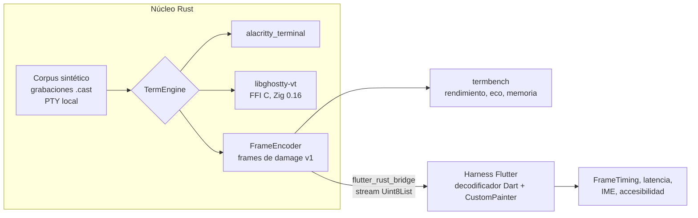

# Spike S1 — Motor de terminal

- **Estado:** en preparación. S1.0 está hecho: interfaz común, formato de frames, backend `alacritty_terminal` y `termbench`.
- **Fecha:** 2026-10-08.
- **Decide:** [ADR-002](../adr/ADR-002-motor-de-terminal.md).
- **Duración estimada:** 15–20 días de trabajo (dentro de las 4–6 semanas de la fase 0).

## 1. Pregunta

¿Qué motor VT (**`alacritty_terminal`** o **`libghostty-vt`**), con un **render propio en Flutter**, cumple la puerta del ADR-002 en Windows, macOS, Linux, Android e iOS, y con cuánto trabajo propio?

## 2. Hipótesis

| # | Hipótesis | Cómo se refuta |
|---|---|---|
| H1 | Los dos motores procesan la salida mucho más rápido de lo que llega por red (≥ 50 MiB/s en móvil de gama media) | `termbench run` en un dispositivo Android de gama media |
| H2 | El scrollback de `alacritty_terminal` (~26 B/celda) no cabe en el presupuesto de memoria con 40.000 líneas; `libghostty-vt`, con celdas compactas, sí | `termbench mem` con ambos motores |
| H3 | Un `CustomPainter` con caché de filas pinta un redibujado completo de 200×50 en < 16 ms p95 en un Android de gama media | Harness de render + `FrameTiming` |
| H4 | La composición IME (japonés, chino, coreano) y el teclado de Android funcionan con un `TextInputClient` propio | Pruebas manuales guiadas (§7) |
| H5 | Con `alacritty_terminal` tendremos que escribir la codificación de teclado y ratón (xterm y protocolo de teclado kitty); `libghostty-vt` la trae | Inventario de lo implementado al final del spike |

## 3. Alcance

**Dentro del alcance:** estado VT, formato de frames entre núcleo y UI, render, entrada (teclado, IME, ratón, pegado), scroll y scrollback, memoria, corrección con apps reales y una accesibilidad básica.

**Fuera del alcance:** SSH (S2), firmantes (S3), selección y búsqueda avanzadas, ligaduras, imágenes (sixel/kitty), temas y pulido visual.

## 4. Montaje



- **`core/crates/openward-term`**: el trait `TermEngine`, el formato de frames v1 (documentado en `frame.rs`, con decodificador de referencia) y el backend `alacritty` con pruebas. **Hecho.**
- **`spikes/s1-terminal/termbench`**: CLI que mide la parte del núcleo. **Hecho:** `gen`, `run`, `replay` (asciicast v2/v3), `echo` y `mem`, con salida en texto o JSON.
- **`spikes/s1-terminal/render_harness`**: app Flutter que recibe frames por `flutter_rust_bridge`, los decodifica en Dart y los pinta. **Pendiente** (S1.4).

## 5. Corpus

| Tipo | Contenido | Estado |
|---|---|---|
| Sintético (`termbench gen`) | `ascii` (cat de un log), `sgr-log` (16, 256 y truecolor), `unicode` (CJK, emoji, combinantes, caracteres de caja), `fullscreen` (estilo htop, pantalla alternativa), `scroll-region` (estilo vim o less, DECSTBM) | Hecho, determinista |
| Grabaciones reales (asciinema 2.4, 200×50) | vim editando, htop, tmux con 4 paneles, `cat` de 300.000 líneas de log variado (70 MB), `ls -laR` coloreado, barras de progreso estilo npm, `man tmux` en less, vim con texto CJK y emoji, **TUI de un agente de IA** (redibujado intenso) | **Hecho** (S1.1) |

Las grabaciones se hacen **dentro de un contenedor desechable con datos sintéticos**, para que ningún `.cast` contenga rutas, hosts ni datos personales. Se guardan en `spikes/s1-terminal/corpus/casts/` solo si pesan menos de 5 MB; las grandes se regeneran con un script.

## 6. Métricas y puerta

| Métrica | Herramienta | Umbral para aceptar |
|---|---|---|
| Throughput de parseo | `termbench run` | ≥ 50 MiB/s en un Android de gama media con todo el corpus |
| `cat` de 100 MB con la UI | Harness de render | Ningún frame congelado > 100 ms; la UI sigue respondiendo |
| Latencia del eco en el núcleo | `termbench echo` | p99 < 1 ms en todas las plataformas |
| Latencia del eco de una tecla, desde los datos recibidos hasta el pintado | Harness, carga de tecleo con bytes sueltos (`FrameTiming` + marca de tiempo del núcleo) | p95 < 1 refresco + 4 ms a 200×50 (≈ 21 ms a 60 Hz, ≈ 12 ms a 120 Hz) |
| Flujo continuo (salida masiva) | Harness, cargas del corpus al máximo ritmo | ≥ 55 fps y construcción + raster p95 < 1 refresco |
| Corrección | `vttest` (pantallas 1–3 y 8), vim, tmux, htop, mc, less, corpus `unicode` | Sin errores visibles; diferencias documentadas |
| IME | Japonés, chino pinyin, coreano; Gboard y teclado de iOS | Composición visible en el cursor y texto confirmado correcto |
| **Memoria de scrollback** | `termbench mem` | **< 300 MB con 10 pestañas × 10.000 líneas × 120 columnas.** Un valor por defecto de 40.000 líneas solo si hay scrollback compacto |
| Accesibilidad | VoiceOver y TalkBack | Se puede leer la pantalla visible fila a fila (viable, no perfecto) |

Gana el motor que pasa la puerta. Si pasan los dos, se puntúa:

| Criterio | Peso |
|---|---|
| Memoria de scrollback | 25 % |
| Trabajo propio pendiente (codificadores de entrada, búsqueda, scrollback compacto) | 25 % |
| Estabilidad de la API y riesgo de mantenimiento | 20 % |
| Complejidad de build (Zig, cross-compilación a 5 plataformas, tamaño del binario) | 15 % |
| Rendimiento medido | 15 % |

## 7. Plataformas y dispositivos

| Plataforma | Dispositivo mínimo | Notas |
|---|---|---|
| macOS | Mac con Apple Silicon (máquina de desarrollo) | También Intel si hay acceso |
| Windows | Windows 11 x64 (VM o equipo) | ConPTY para la terminal local; teclado ES e IME de Microsoft |
| Linux | Ubuntu 24.04, X11 y Wayland | IBus/Fcitx5 para el IME |
| Android | **Gama media** (por ejemplo, Pixel 6a o Galaxy A5x) y uno de gama baja | `termbench` cruzado a `aarch64-linux-android` y ejecutado por `adb` |
| iOS | iPhone 12 o posterior, y un iPad con teclado | `termbench` como prueba dentro del harness (iOS no permite ejecutables sueltos) |

## 8. Tareas

| ID | Tarea | Días | Estado |
|---|---|---|---|
| S1.0 | Trait `TermEngine`, formato de frames v1, backend `alacritty_terminal`, `termbench` | 1 | **Hecho** |
| S1.1 | Grabar el corpus real en un contenedor y añadir el script de regeneración | 1 | **Hecho** (§10.5) |
| S1.2 | `termbench` con alacritty en las 5 plataformas; resultados en `spikes/s1-terminal/results/<plataforma>.jsonl` | 1–2 | Pendiente |
| S1.3 | Backend `libghostty-vt`: build con Zig 0.16.0 al commit fijado (`ghostty-engine/GHOSTTY_COMMIT`), bindings generados con `bindgen` en un crate aislado del spike, `TermEngine` y medición contra alacritty | 3–4 | **Hecho** en macOS; enlaza para Android e iOS (§10.4) |
| S1.4 | Harness de render: app Flutter + `flutter_rust_bridge` 2.13.0, decodificador Dart del frame v1 con pruebas cruzadas contra frames de ejemplo generados en Rust, y `CustomPainter` con un `Picture` en caché por fila (solo se regraban las filas que cambian) | 3–4 | **En curso:** v1 (async) y v2 (sync) medidos en macOS (§10.2) |
| S1.4b | Carga de tecleo (bytes sueltos a intervalos aleatorios) para medir el eco | 0,5 | **Hecho** en macOS: pasa la puerta (§10.2) |
| S1.4c | Render con atlas de glifos (`drawRawAtlas`), con párrafo de respaldo para emoji y clústeres raros; comparar el coste de grabación con v2 | 1–2 | **Hecho** en macOS: 2–3× más barato (§10.3) |
| S1.5 | Entrada: codificación de teclas (xterm y protocolo kitty), ratón (SGR 1006), bracketed paste; IME con `TextInputClient` y región de composición en el cursor; barra de teclas en móvil | 2–3 | Pendiente |
| S1.6 | Corrección: vttest, apps reales y corpus unicode en ambos motores; capturas comparadas | 1–2 | Pendiente |
| S1.7 | Si se confirma H2: prototipo de scrollback compacto (texto UTF-8 con tramos de estilo para las líneas que salen de la pantalla) y medición | 2 | Condicional |
| S1.8 | Informe `S1-terminal-resultados.md` y ADR-002 aceptado | 1 | Pendiente |

**Requisitos previos:** Rust 1.99.0 (fijado en `rust-toolchain.toml`), Flutter 3.47.6 (fijado en `.fvmrc`; se usa con `fvm flutter …`, sin tocar el Flutter global), Zig 0.16.0 (`zig@0.16` de Homebrew), `flutter_rust_bridge_codegen` 2.13.0, Android NDK y Xcode 27.

## 9. Riesgos del spike

| Riesgo | Mitigación |
|---|---|
| La API de `libghostty-vt` cambia durante el spike | Fijar el commit exacto de Ghostty; adaptador fino; medir el coste de seguirla |
| Cross-compilar Zig a Android o iOS da problemas | Usar el xcframework y el job de Android que ya tiene Ghostty; si falla en móvil, documentarlo como criterio |
| El render en Flutter no llega a 16 ms en gama media | Probar a pintar en un `Picture` por fila y, como último recurso, un atlas de glifos con `drawRawAtlas` |
| IME coreano o el teclado de Android se comportan mal (problemas conocidos en otros terminales Flutter) | Reservar S1.5 completo; probar en dispositivos reales, no en emulador |
| Las grabaciones filtran datos | Solo contenedor desechable; revisión antes de commitear |

## 10. Resultados preliminares (S1.0, smoke test)

2026-10-08 · Mac con Apple Silicon · build de release · `alacritty_terminal` 0.26.0 · 200×50 · corpus sintético de 4 MiB por archivo, troceado en bloques de 4 KiB y con un frame cada 64 KiB. **Son orientativos, no la medición del spike.**

| Entrada | Parseo | Con frames | Frame medio | `encode_damage` p95 |
|---|---|---|---|---|
| ascii | 98 MiB/s | 102 MiB/s | 7,3 KB | 63 µs |
| sgr-log | 134 MiB/s | 149 MiB/s | 11,9 KB | 70 µs |
| unicode | 108 MiB/s | 118 MiB/s | 26,8 KB | 82 µs |
| fullscreen | 217 MiB/s | 190 MiB/s | 7,5 KB | 52 µs |
| scroll-region | 190 MiB/s | 166 MiB/s | 8,8 KB | 57 µs |

- **Eco** (una tecla, un frame): p50 0,9 µs, p99 1,5 µs. Despreciable frente a la red y el pintado.
- **Memoria:** 2 pestañas × 5.000 líneas × 200 columnas ocupan ~52 MB, es decir, **~5,3 KB por línea (~26 B por celda)**. Extrapolado, 10 pestañas × 40.000 líneas × 200 columnas serían ~2 GB. **Esto refuerza H2.** El objetivo de memoria original del ADR-002 era inalcanzable con este motor sin scrollback compacto, y la puerta queda redefinida en §6.
- **Frames:** un frame completo de 200×50 pesa 7–27 KB; a 60 Hz son menos de 2 MB/s por el bridge, sin problema.
- **Móvil:** `openward-term` con `alacritty_terminal` compila (`cargo check`) para `aarch64-apple-ios`, `aarch64-apple-ios-sim`, `aarch64-linux-android` y `x86_64-linux-android`. Falta ejecutarlo en dispositivo (S1.2). El CI lo comprueba en cada cambio.

### 10.2 Banco de render en Flutter (S1.4)

2026-10-13 · Apple M5 · pantalla a 60 Hz · macOS release, Impeller (Metal) · Flutter 3.47.6 · `alacritty_terminal` · 200×50 · scrollback de 10.000 líneas · se descarta el primer medio segundo (calentamiento de shaders). Datos en `spikes/s1-terminal/results/macos-render-v*.jsonl`.

| Carga (ritmo) | fps | Latencia p50 v1 → v2 | Latencia p95 v2 | Construcción p95 v2 | Raster p95 v2 | Grabación de filas p95 v2 |
|---|---|---|---|---|---|---|
| fullscreen (máx.) | 60 | 33,3 → 21,5 ms | 21,7 ms | 5,3 ms | 0,6 ms | 4,9 ms |
| sgr-log (máx.) | 60 | 33,3 → 22,9 ms | 23,6 ms | 7,1 ms | 0,8 ms | 6,8 ms |
| unicode (máx.) | 59 | 33,4 → 27,8 ms | 31,9 ms | 16,3 ms | 1,4 ms | 15,4 ms |
| scroll-region (máx.) | 60 | 33,3 → 20,7 ms | 21,0 ms | 4,5 ms | 0,6 ms | 4,3 ms |
| ascii (máx.) | 60 | 33,3 → 19,6 ms | 20,3 ms | 3,8 ms | 0,6 ms | 3,5 ms |
| fullscreen (2 MiB/s) | 60 | 32,4 → 20,3 ms | 21,1 ms | 4,9 ms | 0,7 ms | 4,6 ms |
| sgr-log (1 MiB/s) | 60 | 31,4 → 19,9 ms | 21,6 ms | 5,8 ms | 0,8 ms | 5,6 ms |

v1 pedía el frame a Rust de forma asíncrona en cada tick; v2 lo pide de forma síncrona dentro del tick. Codificar cuesta 50–100 µs en p95.

**Conclusiones:**

1. **La vía asíncrona añade un refresco entero** (~33 ms frente a ~20 ms): el frame llega cuando el refresco actual ya ha empezado. **Decisión para el producto:** codificar en el hilo de UI dentro del tick de vsync. Cuesta decenas de µs y elimina un refresco de latencia.
2. **Pintar es barato:** el raster p95 está entre 0,6 y 1,4 ms y la app va a 60 fps estables, sin frames congelados tras el calentamiento, incluso con salida masiva.
3. **El cuello de botella es grabar las filas en Dart** con un `Paragraph` por tramo de estilo: 3,5–15 ms en p95, y llega casi al presupuesto entero del refresco con CJK y emoji. En un Android de gama media puede ser varias veces más lento. **Siguiente iteración (S1.4c):** atlas de glifos con `drawRawAtlas`, que evita dar forma al texto en cada frame, y párrafo solo para lo que el atlas no cubra.
4. **La métrica de latencia original estaba mal planteada para flujos continuos.** El byte más antiguo de cada frame espera por construcción casi un refresco entero, así que "p95 < 16 ms" era imposible a 60 Hz. La latencia que percibe el usuario es la del eco de una tecla aislada: la puerta pasa a "p95 < 1 refresco + 4 ms" con una carga de tecleo (S1.4b). Los flujos continuos se evalúan por fps y por tiempo de frame (§6).
5. **El eco de tecla pasa la puerta en macOS (S1.4b).** La carga `typing` envía bytes sueltos cada 60–180 ms sobre una pantalla ya llena, como el eco del shell al escribir. Dos ejecuciones de 20 s (334 pulsaciones), vía síncrona, pantalla a 60 Hz:

   | Ejecución | Pulsaciones | p50 | p95 | p99 | Máx. | Puerta (1 refresco + 4 ms) |
   |---|---|---|---|---|---|---|
   | 1 | 166 | 8,8 ms | 17,4 ms | 18,9 ms | 40,3 ms | 20,7 ms → **pasa** |
   | 2 | 168 | 9,2 ms | 17,1 ms | 17,9 ms | 44,2 ms | 20,7 ms → **pasa** |

   El p50 (~9 ms) es medio refresco de espera más ~1 ms de proceso, el mínimo posible a 60 Hz. Grabar la única fila que cambia cuesta < 1 ms. Hay picos aislados de ~40 ms (menos del 1 % de las pulsaciones) que conviene investigar en Android. El raster p95 sube a 3,7–4,8 ms con este ritmo intermitente, probablemente porque la GPU baja de frecuencia entre pulsaciones. En una pantalla de 120 Hz o más la puerta se estrecha (~12 ms) y habrá que repetir la medición.
6. **Toolchain dentro de la build de Flutter:** cargokit solo aceptaba `stable`, `beta` o `nightly`, así que compilaba con el `stable` de la máquina y no con la versión fijada. Se ha parcheado la copia de cargokit del harness (`build_tool/lib/src/options.dart`) para aceptar una versión exacta, y `rust/cargokit.yaml` fija la 1.99.0. Habrá que proponer el cambio upstream o mantener el parche en la app real.

### 10.3 Atlas de glifos frente a párrafos (S1.4c)

2026-10-13 · mismas condiciones que §10.2 · las dos baterías seguidas en la misma sesión · vía síncrona. Datos en `results/macos-render-v4-{atlas,paragraph}.jsonl`. Selección con `--dart-define=S1_RENDERER=atlas|paragraph` y capturas con `S1_SNAPSHOT_DIR`.

**Cómo funciona el atlas:** cada glifo (texto del clúster × negrita/cursiva × 1 o 2 celdas) se rasteriza una vez, en blanco y a resolución física, en una textura que solo crece. Cada fila se graba con una única llamada `drawRawAtlas` que tiñe los glifos con su color (`BlendMode.modulate`). Los emoji y los clústeres que no encajan con las celdas usan el párrafo de antes.

| Carga | Grabación p95: párrafo → atlas | Construcción p95 | Raster p95 | Latencia p95 | Glifos en el atlas |
|---|---|---|---|---|---|
| fullscreen | 3,28 → **1,23 ms** (2,7×) | 3,64 → 1,46 ms | 0,49 → 0,28 ms | 20,0 → 18,0 ms | 53 |
| sgr-log | 4,34 → **2,12 ms** (2,0×) | 4,53 → 2,37 ms | 0,60 → 0,32 ms | 21,1 → 18,9 ms | 69 |
| unicode | 10,32 → **3,12 ms** (3,3×) | 10,68 → 3,51 ms | 1,26 → 0,82 ms | 27,1 → 20,0 ms | 103 |
| scroll-region | 3,53 → **1,32 ms** (2,7×) | 3,72 → 1,52 ms | 0,60 → 0,28 ms | 20,3 → 18,1 ms | 103 |
| ascii | 2,86 → **2,24 ms** (1,3×) | 3,04 → 2,49 ms | 0,44 → 0,33 ms | 19,6 → 18,9 ms | 143 |
| typing (eco) | 0,63 → **0,22 ms** | 1,01 → 0,60 ms | 3,10 → 1,48 ms | 17,0 → **16,2 ms** (máx. 20,4) | 143 |

**Conclusiones:**

1. **El atlas abarata la grabación entre 2 y 3,3 veces**, y el peor caso (unicode) baja de 10,3 a 3,1 ms. El presupuesto de un refresco a 60 Hz queda con margen de sobra en un M5. Queda pendiente confirmarlo en Android de gama media.
2. **El eco sigue pasando la puerta:** p95 de 16,2 ms frente a 20,7 ms, con el máximo en 20,4 ms.
3. **El atlas es pequeño:** 143 glifos tras toda la batería, en una textura de 1024×256 px.
4. **Calidad visual** (capturas comparadas a mano):
   - **Igual en ambos:** posiciones y anchos coinciden en todo el corpus (CJK, hangul, cirílico, griego, acentos combinados y emoji por la vía de respaldo).
   - **Distinto:** con el atlas el texto sale algo más grueso, seguramente por el ajuste de contraste al rasterizar glifos blancos. Hay que afinarlo en S1.6.
5. **Problemas de corrección encontrados (para S1.6):**
   - **Emoji con modificador de tono:** `alacritty_terminal` parte 👍🏽 en dos celdas (👍 + cuadrado de color). Es un criterio a comparar con `libghostty-vt`, que soporta el modo de grafemas 2027.
   - **Caracteres de caja:** dejan huecos verticales con interlineado 1,2. Los terminales maduros los dibujan de forma procedural para que llenen la celda.
6. **Robustez del arnés:**
   - **Sin vsync, sin frames:** macOS deja de producir frames para ventanas tapadas u ocultas. Un vigilante aborta la prueba (`error: no-vsync`) si pasan 5 s sin frame.
   - **App Nap desactivado** en el arnés.
   - **Sandbox desactivado** en el arnés para poder escribir las capturas. La app real sí irá con sandbox.

### 10.4 `libghostty-vt` frente a `alacritty_terminal` (S1.3)

2026-10-13 · Apple M5 · release · Ghostty en el commit `05dcf887` (main, 2026-10-12) · corpus de 16 MiB por carga · 200×50 · scrollback de 10.000 líneas. Datos en `results/macos-engines-s1.3.jsonl`.

**Integración:**
- **Código:** el motor vive en `spikes/s1-terminal/ghostty-engine`. Los bindings (`src/sys.rs`, 199 funciones con comprobación de layout en compilación) se generan con `bindgen` y se commitean, así que la build normal no necesita libclang.
- **Compilación:** `build-libghostty.sh` compila la librería estática por destino en la caché del usuario. `termbench` la usa con `--features ghostty`.
- **Detalles para que funcione:**
  - enlazar desde un directorio que solo contenga el `.a`, porque el enlazador de macOS prefiere la `.dylib`;
  - activar el modo de grafemas 2027 como valor por defecto;
  - quitar el límite de historial por bytes para comparar en igualdad;
  - omitir los espacios sin estilo, igual que con alacritty.
- **Pruebas:** las mismas 7 de alacritty más dos, el emoji con modificador y la memoria con compresión: **9/9**.

**Rendimiento del núcleo:**

| Carga | Parseo alacritty → Ghostty | Con frames | `encode_damage` p95 |
|---|---|---|---|
| ascii | 242 → **840 MiB/s** | 200 → 367 MiB/s | 55 → 108 µs |
| fullscreen | 226 → **355 MiB/s** | 196 → 234 MiB/s | 45 → 103 µs |
| scroll-region | 198 → **841 MiB/s** | 174 → 399 MiB/s | 47 → 89 µs |
| sgr-log | **241** → 192 MiB/s | 194 → 140 MiB/s | 63 → 125 µs |
| unicode | **177** → 149 MiB/s | 148 → 123 MiB/s | 75 → 112 µs |
| eco (una tecla) | p99 1,4 → 2,6 µs | | |

Ghostty parsea mucho más rápido el texto plano y el scroll, y algo más lento el color intenso y el Unicode. Codifica el frame en el doble de tiempo porque el adaptador hace varias llamadas FFI por celda; se puede agrupar con `row_cells_get_multi`. Todo está muy por encima de lo necesario.

**Memoria (criterio de mayor peso):**

| Medición | alacritty | Ghostty | Ghostty con compresión |
|---|---|---|---|
| **Puerta:** 10 pestañas × 10.000 líneas × 120 col. | 322 MB → **no pasa** (< 300) | 104 MB → **pasa** | 5,8 MB |
| 2 pestañas × 40.000 líneas × 200 col. | 409 MB (~5,3 KB/línea) | 136 MB (~1,8 KB/línea) | 2,3 MB |

Ghostty ocupa unas 3 veces menos. Además, `ghostty_terminal_compress` (pensado para tiempo ocioso) reduce el historial más de 15 veces con este corpus. Cuidado: el corpus de memoria repite el mismo texto y se comprime de forma irreal, así que hay que repetirlo con grabaciones reales (S1.1). **H2 se confirma:** sin scrollback compacto, alacritty no pasa la puerta.

**Plataformas y tamaño:**
- **macOS:** medido.
- **Android arm64:** compila con el NDK r28 y `termbench` con los dos motores enlaza como ELF para `/system/bin/linker64`.
- **iOS arm64:** el xcframework trae las partes de dispositivo y simulador, y el ejecutable de pruebas enlaza.
- **Pendiente:** ejecutar en dispositivos (S1.2).
- **Tamaño:** Ghostty añade +1 MB al binario sin símbolos (0,8 → 1,8 MB).

**Corrección encontrada:** con el modo 2027, Ghostty mantiene 👍🏽 en una sola celda ancha; alacritty lo parte en dos.

**Puntuación provisional** (§6; las notas de 0 a 10 son valoración del equipo con los datos de arriba):

| Criterio | Peso | alacritty | Ghostty | Por qué |
|---|---|---|---|---|
| Memoria de scrollback | 25 % | 3 | 10 | alacritty no pasa la puerta; Ghostty pasa y además comprime |
| Trabajo propio pendiente | 25 % | 5 | 9 | Ghostty trae grafemas, codificadores de teclado y ratón, búsqueda, compresión y gráficos kitty |
| Estabilidad de API y mantenimiento | 20 % | 7 | 4 | La API C de Ghostty "está en flujo" y no tiene versión: hay que fijar el commit y mantener un adaptador |
| Complejidad de build | 15 % | 10 | 4 | Zig 0.16 exacto, NDK y una librería precompilada por destino |
| Rendimiento | 15 % | 8 | 8 | Los dos sobran; cada uno gana en cargas distintas |
| **Total ponderado** | | **6,1** | **7,4** | |

**Recomendación provisional: `libghostty-vt`.** Es el único motor que pasa la puerta de memoria y el que menos trabajo propio deja (codificadores de entrada para S1.5, grafemas, compresión). El coste es la API inestable y la build con Zig, que se mitigan con el commit fijado, el adaptador `TermEngine` y bindings regenerables. Antes de aceptar el ADR-002 (S1.8) faltan:
- ejecutar en Android e iOS reales (S1.2);
- probar la entrada y el IME con sus codificadores (S1.5);
- probar la corrección con apps reales (S1.6);
- repetir la memoria con grabaciones reales (S1.1).

### 10.5 Corpus de sesiones reales (S1.1)

2026-10-13 · grabado con `make corpus` (`corpus/record.sh`) en un contenedor Debian trixie **sin red** (`--network=none`).

**Cómo se graba:**
- **Apps a pantalla completa:** vim, man y less se manejan con un conductor PTY propio (`drive.py`) que teclea con retardos de décimas de segundo y reenvía la salida sin cortes. Con `expect` toda la salida llegaba de golpe al final.
- **Datos:** sintéticos pero variados, para que no se repitan:
  - logs con UUID, IPs, latencias, JSON y trazas;
  - código Python;
  - texto con CJK, hangul, acentos y emoji.
- **Privacidad:** `check-casts.sh` comprueba que ninguna grabación contiene el usuario, el host ni rutas del Mac: **0 fugas**.

**Qué se guarda:**
- **Grabaciones pequeñas** (`corpus/casts/`, 3,5 MB en total): se commitean.
- **Grabaciones grandes** (`casts-big/`: `cat-log` de 70 MB y `ls -laR` de 0,9 MB): se regeneran y nunca se commitean.

**Reproducción con los dos motores** (`termbench replay`, datos en `results/macos-real-corpus-s1.1.jsonl`):

| Grabación | Parseo alacritty → Ghostty |
|---|---|
| agent-tui (TUI de agente) | 147 → **560 MiB/s** |
| cat-log (300.000 líneas) | 240 → **483 MiB/s** |
| tmux-4panes | 195 → **324 MiB/s** |
| ls-recursive | 132 → **324 MiB/s** |
| man-tmux | 131 → **178 MiB/s** |
| vim-edit | 203 → 206 MiB/s |
| progress | 250 → 247 MiB/s |
| vim-cjk | **219** → 158 MiB/s |
| htop | **100** → 72 MiB/s |

Las grabaciones de vim, htop y man son cortas, así que sus cifras tienen más ruido. Los frames coinciden byte a byte entre los dos motores salvo en vim-cjk, donde Ghostty agrupa grafemas.

**Memoria con logs reales** (`termbench mem casts-big/cat-log.cast`, un tramo distinto por pestaña; el RSS de partida incluye la grabación cargada, unos 130 MB, y se descuenta):

| Medición | alacritty | Ghostty | Ghostty con compresión |
|---|---|---|---|
| **Puerta:** 10 pestañas × 10.000 líneas × 120 col. | ~320 MB (3,3 KB/línea) → **no pasa** | 98 MB → **pasa** | **15 MB (6,4×)** |
| 2 pestañas × 40.000 líneas × 200 col. | ~407 MB (5,3 KB/línea) | 132 MB | **18 MB (7,5×)** |

**Conclusiones:**
1. **La compresión real es de unas 6–7,5 veces**, no las 15–50 del corpus sintético, pero sigue siendo decisiva. Con Ghostty y compresión en reposo, 10 pestañas con 40.000 líneas de 200 columnas ocuparían unos 90 MB frente a ~2 GB con alacritty. **Un historial por defecto de 40.000 líneas es viable con Ghostty.**
2. Con contenido real Ghostty también **parsea más rápido** en casi todo; solo pierde en htop y en vim con CJK.
3. **Cómo se midió:** la TUI de agente no se usa para memoria, porque redibuja con el cursor y apenas llena el historial. Para memoria cuentan las grabaciones orientadas a líneas.

## 11. Cómo reproducir

```bash
cd spikes/s1-terminal/termbench
cargo build --release
./target/release/termbench gen ../corpus/synthetic --mb 16
./target/release/termbench run ../corpus/synthetic/*.txt --json > ../results/macos.jsonl
./target/release/termbench echo --json >> ../results/macos.jsonl
./target/release/termbench mem --tabs 10 --scrollback 10000 --cols 120 --json >> ../results/macos.jsonl

# Motor libghostty-vt (Zig 0.16: brew install zig@0.16)
../ghostty-engine/build-libghostty.sh                      # host
ANDROID_NDK_HOME=~/Library/Android/sdk/ndk/<versión> \
  ../ghostty-engine/build-libghostty.sh aarch64-linux-android
cargo build --release --features ghostty
./target/release/termbench run ../corpus/synthetic/*.txt --engine all
./target/release/termbench mem --engine ghostty --tabs 10 --scrollback 10000 --cols 120
```
